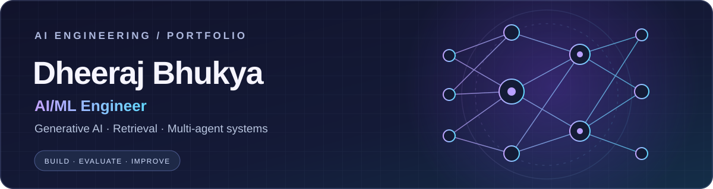
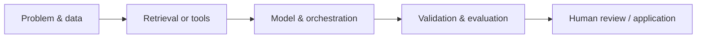

### Building practical AI systems, from retrieval to intelligent agents.

## About me

I'm an AI/ML engineer focused on **Generative AI, retrieval-augmented generation and multi-agent systems**. I enjoy connecting language models with useful tools, building grounded retrieval pipelines, and developing applications with clear interfaces and testable behavior.

- **Generative AI:** LLM applications, prompt design and structured outputs.
- **Agentic systems:** LangChain, LangGraph, tool calling and human-in-the-loop workflows.
- **Retrieval:** document ingestion, embeddings, vector search and RAG evaluation.
- **Engineering:** Python APIs, interactive applications, automated checks and reproducible workflows.

## Featured projects

| Project | What it demonstrates |
| :--- | :--- |
| [**JOBHUNT**](https://github.com/dheerajbhukya7/JOBHUNT) | AI-assisted job discovery, resume matching, LLM screening and human-reviewed drafts. |
| [**Multi-Agent Research System**](https://github.com/dheerajbhukya7/Multi-Agent-Research-System) | Web search, content extraction, report generation and critique. |
| [**RAG Book Assistant**](https://github.com/dheerajbhukya7/RAG-BOOK-ASSISTANT) | PDF question answering with FAISS, Hugging Face embeddings and Mistral. |
| [**City Intelligence Agent**](https://github.com/dheerajbhukya7/city-intelligence-agent) | Tool calling with weather and news APIs through Groq and Tavily. |
| [**Portfolio**](https://github.com/dheerajbhukya7/PORTFOLIO) | Responsive React and TypeScript site with a searchable project gallery. |
| [**Movie Info Extractor**](https://github.com/dheerajbhukya7/movie-info-extractor) | Structured movie information extraction with Mistral and Pydantic. |

## Technology stack

**Generative AI & agents**

**Machine learning & application engineering**

## How I approach AI engineering

I value grounded answers, reliable tool execution, explicit limitations and measurable evaluation. Explore each project for its architecture, implementation and current scope.

## More experiments

[AI Quote Generator](https://github.com/dheerajbhukya7/AI-Quote-Generator) · [Emotional Weather Station](https://github.com/dheerajbhukya7/Emotional-weather-station) · [Personality Chatbot](https://github.com/dheerajbhukya7/EMOTIONAL-CAHTBOT) · [Manasik Santhulan Score](https://github.com/dheerajbhukya7/MANASIK-SANTHULAN-SCORE)

---

**Build useful AI. Make it understandable. Keep improving.**

[Explore my repositories](https://github.com/dheerajbhukya7?tab=repositories) · [Visit my portfolio](https://portfolio-tau-one-rejpw4hut7.vercel.app/)

